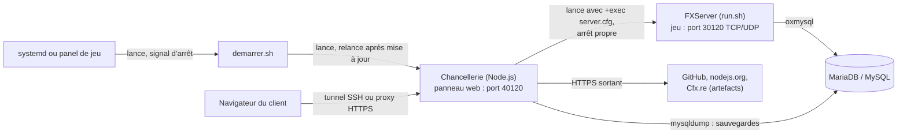

# Remplacer txAdmin par la Chancellerie vAvA — procédure pour l'hébergeur

La Chancellerie remplace txAdmin sur ce serveur FiveM : c'est elle qui lance FXServer (avec `+exec server.cfg`, donc
**sans txAdmin**), le surveille, et tient le framework vAvA à jour depuis GitHub. De votre côté, il suffit de poser son
dossier et de la lancer **à la place** de FXServer. Le client fait ensuite le reste depuis le navigateur.

## En bref : ce que nous vous demandons

1. Une machine ou un conteneur **Linux à glibc** (Debian, Ubuntu) avec `bash`, `curl` (ou `wget`), `tar`, `xz` et
   l'accès Internet sortant listé plus bas.
2. Une **base MySQL ou MariaDB** et ses identifiants (hôte, port, utilisateur, mot de passe, nom de la base).
3. Le dossier **`chancellerie/`** posé à côté des données du serveur (commande plus bas).
4. Lancer **`demarrer.sh`** au lieu de FXServer (service systemd, ou commande de démarrage du panel).
5. **Deux ports** : celui du jeu (30120 par défaut, TCP et UDP) et celui du panneau web (40120 par défaut, TCP), comme
   pour txAdmin.

## Prérequis

| Élément | Détail | Pourquoi |
| --- | --- | --- |
| Système | Linux x86-64 ou arm64, glibc (Debian 11+, Ubuntu 20.04+) | Node.js officiel et FXServer |
| Outils | `bash`, `curl` ou `wget`, `tar`, `xz-utils`, `sha256sum` | lanceur, téléchargements, archives |
| Node.js | 22 ou plus récent (18 suffit sans le bot Discord) ; **absent ou plus ancien : téléchargé seul** (v22, empreinte SHA-256 vérifiée) dans `chancellerie/node/` | la Chancellerie est en Node.js, sans dépendance npm |
| Base de données | MariaDB 10.6+ ou MySQL 8, une base dédiée (`utf8mb4`) et un utilisateur qui a tous les droits dessus | comptes, personnages, inventaires ; les tables sont créées par vAvA |
| Client MariaDB (conseillé) | `mariadb-client` (`mysqldump`, `mysql`) | sauvegardes de la base depuis le panneau ; création de la base |
| Internet sortant (HTTPS) | `github.com`, `api.github.com`, `codeload.github.com`, `*.githubusercontent.com`, `nodejs.org`, `changelogs-live.fivem.net`, `runtime.fivem.net`, `discord.com`, `gateway.discord.gg` (WebSocket) | vAvA et ses mises à jour, oxmysql, Node.js, FXServer, bot Discord |
| Ports entrants | jeu : 30120 TCP + UDP ; panneau : 40120 TCP (ou ceux que vous attribuez) | joueurs ; administration |
| Disque | ~1 Go (FXServer, Node.js, ressources) + les sauvegardes de la base | |

## Le fichier à installer

Un seul dossier : **`chancellerie/`**, tiré du dépôt GitHub `Nicolasbriet/vAvA_core` (branche `main`). Il ne faut **pas**
le cloner avec git : une copie suivie par git ne se met jamais à jour seule (c'est voulu). La commande suivante récupère
seulement ce dossier, dans le répertoire courant :

```sh
curl -L https://github.com/Nicolasbriet/vAvA_core/archive/refs/heads/main.tar.gz \
  | tar -xz --strip-components=1 vAvA_core-main/chancellerie
```

Archive complète, si vous préférez la télécharger vous-même :
<https://github.com/Nicolasbriet/vAvA_core/archive/refs/heads/main.tar.gz> (n'en garder que `chancellerie/`).

Où le poser : **à côté du dossier qui contient `resources/` et `server.cfg`** (la Chancellerie le trouve seule), par
exemple `/opt/vava/chancellerie` ou `/home/container/chancellerie`. Ses données (comptes, réglages, journaux,
sauvegardes) vivent dans `chancellerie/data/` : à garder lors d'une réinstallation, à ne jamais partager.

## Cas A — VPS ou serveur dédié (accès root)

```sh
# 1. outils et base de données
sudo apt install -y curl xz-utils mariadb-server mariadb-client

# 2. un utilisateur système pour le serveur, et son dossier
sudo useradd -m -s /bin/bash fivem
sudo mkdir -p /opt/vava && sudo chown fivem: /opt/vava

# 3. la Chancellerie
cd /opt/vava
sudo -u fivem bash -c 'curl -L https://github.com/Nicolasbriet/vAvA_core/archive/refs/heads/main.tar.gz | tar -xz --strip-components=1 vAvA_core-main/chancellerie'

# 4. txAdmin / FXServer actuel : l'arrêter et le désactiver (adaptez le nom du service)
sudo systemctl disable --now fivem   # exemple

# 5. service systemd vava-chancellerie (démarrage avec la machine, relance si elle tombe, arrêt propre)
sudo bash /opt/vava/chancellerie/demarrer.sh --service fivem

# 6. pare-feu : le jeu seulement (le panneau reste local, voir « Accès au panneau »)
sudo ufw allow 30120
```

Le service écrit dans le journal système : `journalctl -u vava-chancellerie -f` affiche le **code d'accès du premier
lancement**, à transmettre au client. Si FXServer et les ressources existent déjà sur la machine, le client les désigne
dans l'assistant (« Serveur déjà en place ») ; sinon l'assistant installe tout dans `/opt/vava/server` et
`/opt/vava/server-data`.

## Cas B — panel de jeu (Pterodactyl ou équivalent, conteneur)

Le panel lance la Chancellerie au lieu de FXServer. Réglages du serveur (ou d'un œuf dédié) :

| Réglage | Valeur |
| --- | --- |
| Image | basée sur Debian/Ubuntu (glibc), avec `bash`, `curl`, `tar`, `xz-utils` ; `mariadb-client` conseillé |
| Commande de démarrage | `exec bash ./chancellerie/demarrer.sh` |
| Variable `CHANCELLERIE_HOST` | `0.0.0.0` (le panneau doit écouter hors du conteneur) |
| Variable `CHANCELLERIE_PORT` | le port attribué au panneau (une seconde allocation, comme celle de txAdmin) |
| Commande d'arrêt | `quit` (ou le signal `^C` / SIGINT) — **jamais un arrêt forcé immédiat** |
| Délai avant arrêt forcé | 60 secondes au moins |
| Texte « serveur démarré » | `Ouvrez dans votre navigateur` |

Installation : poser `chancellerie/` dans le dossier du conteneur (`/home/container/chancellerie`, par la commande
`curl` ci-dessus lancée dans la console ou le gestionnaire de fichiers). Dans l'œuf FiveM courant, les données du
serveur sont dans `/home/container` (`resources/`, `server.cfg`) et FXServer est `/home/container/run.sh` : ce sont les
chemins que le client indiquera dans l'assistant. La commande de démarrage habituelle (FXServer avec `txAdminPort`,
`serverProfile`…) n'est plus utilisée.

Dans la console du panel : le **code d'accès du premier lancement** s'y affiche ; `quit` arrête proprement la
Chancellerie et FXServer ; toute autre ligne tapée part dans la console de FXServer.

## Ce qui tourne



FXServer est un processus enfant de la Chancellerie : c'est elle qui le démarre, l'arrête et le relance après un
plantage. txAdmin ne démarre pas (FXServer est lancé avec `+exec server.cfg`) ; le port 40120 lui est repris.

## Arrêts, redémarrages et mises à jour

- **Arrêt** (systemd, panel, `quit`) : la Chancellerie sauvegarde les personnages (`vava_saveall`), envoie `quit` à
  FXServer, attend jusqu'à 20 s, puis s'arrête. Comptez 30 s au plus ; un arrêt forcé immédiat fait perdre la dernière
  sauvegarde des joueurs.
- **Ne pas lancer ni tuer FXServer à côté d'elle** : elle le relance après un arrêt imprévu (et suspend la relance après
  plus de 3 plantages en 2 minutes).
- **Mises à jour** : la Chancellerie vérifie GitHub toutes les heures. Quand le client applique une mise à jour, elle
  sauvegarde la base et les ressources, arrête proprement, écrit les fichiers de `resources/[vava]/` (en gardant les
  réglages modifiés), relance, puis vérifie que tout tourne ; sinon elle remet l'ancienne version d'elle-même.
- **Mise à jour de la Chancellerie elle-même** : elle remplace ses fichiers dans `chancellerie/`, puis quitte avec le
  **code 75** ; `demarrer.sh` la relance aussitôt (pas le service ni le panel). Si la nouvelle version ne démarre pas,
  `demarrer.sh` remet l'ancienne. Merci de **ne pas restaurer ces fichiers** depuis une ancienne image ou un modèle.
- À sauvegarder de votre côté : `chancellerie/data/`, le dossier des données du serveur (`resources/`, `server.cfg`),
  et la base.

## Accès au panneau et sécurité

- Par défaut, le panneau n'écoute que la machine (127.0.0.1:40120). Le client y accède par un **tunnel SSH**
  (`ssh -L 40120:127.0.0.1:40120 utilisateur@serveur`, puis `http://127.0.0.1:40120/`) : rien à ouvrir.
- Pour un accès direct, comme txAdmin : `CHANCELLERIE_HOST=0.0.0.0` (ou `http.host` dans
  `chancellerie/data/config.json`). Le panneau parle en **HTTP** : idéalement derrière un proxy HTTPS (Caddy, nginx) avec
  `http.secureCookies` à `true` dans ce même fichier.
- Comptes protégés par mot de passe (scrypt), limites de tentatives, journal des actions. Le `server.cfg` (clé de
  licence, mot de passe de la base) n'est jamais affiché dans le navigateur.

## Vérifications après installation

- [ ] `journalctl -u vava-chancellerie` (ou la console du panel) affiche la bannière « La Chancellerie » et un code
      d'accès.
- [ ] Le panneau répond sur son port (tunnel SSH ou adresse publique).
- [ ] Après l'assistant, FXServer démarre (état « En marche » sur le tableau de bord) et le serveur apparaît en jeu.
- [ ] `systemctl stop vava-chancellerie` (ou `quit` dans le panel) : la console montre « Arrêt demandé », puis
      « FXServer est arrêté », en moins de 30 s.
- [ ] La page Performances montre processeur, mémoire et réseau ; la page Sauvegardes trouve `mysqldump`.

## Revenir à txAdmin

Arrêter et désactiver la Chancellerie (`sudo systemctl disable --now vava-chancellerie`, ou remettre la commande de
démarrage d'origine dans le panel), puis relancer FXServer comme avant : `resources/`, `server.cfg` et la base ne sont pas
modifiés par ce retour. Le dossier `chancellerie/` peut rester en place.

Documentation complète de la Chancellerie : [docs/chancellerie.md](chancellerie.md).
